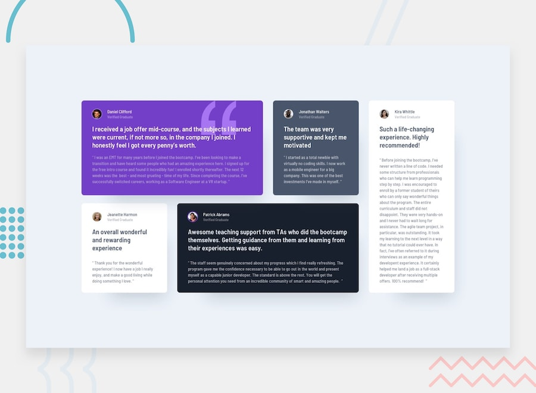

# Frontend Mentor - Testimonials grid section solution

This is a solution to the [Testimonials grid section challenge on Frontend Mentor](https://www.frontendmentor.io/challenges/testimonials-grid-section-Nnw6J7Un7).

## Table of contents

- [Overview](#overview)
  - [The challenge](#the-challenge)
  - [Links](#links)
- [My process](#my-process)
  - [Built with](#built-with)

## Overview

### The challenge

Users should be able to:

- View the optimal layout for the site depending on their device's screen size

### Links

- [Github Repo](https://github.com/JammiM/testimonials-grid-section-fem)
- [live site url](https://jammim.github.io/testimonials-grid-section-fem/)

### Built with

- Semantic HTML5 markup
- CSS custom properties
- Flexbox
- CSS Grid
- Mobile-first workflow
- SCSS
- [html-validate](https://html-validate.org/)
- [stylelint](https://stylelint.io/)
- [Google Lighthouse](https://developer.chrome.com/docs/lighthouse)
